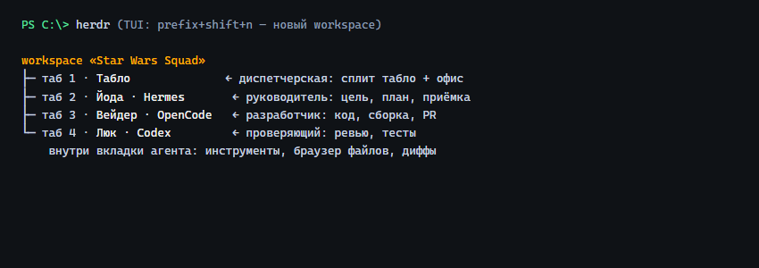
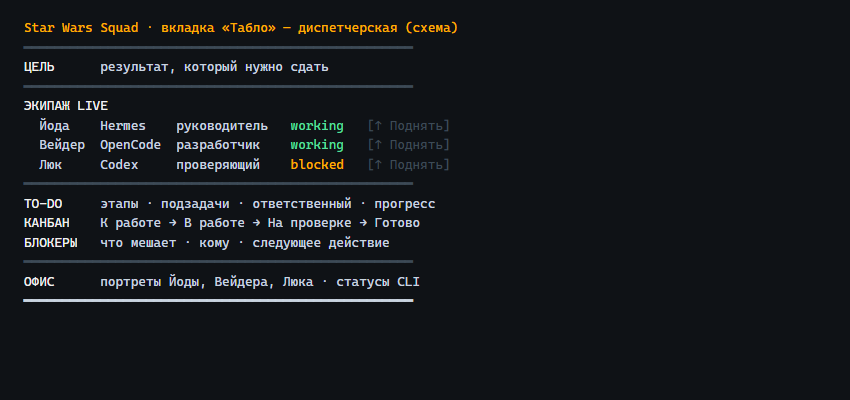

# Herdr Star Wars Squad

   [🇷🇺 Русский](README.md)

**Star Wars Squad** is a ready-made four-agent team for Herdr TUI, assembled per the [herdr-setup skill](https://github.com/Kkoder-Cyclone/Herdr-skill-setup):

- **Yoda** (Hermes) — lead: takes the goal, builds the plan, routes tasks, accepts the result;
- **Vader** (OpenCode) — developer: implements, verifies the build, hands off for review;
- **Luke** (Codex) — reviewer: review, tests, defects, confirming fixes;
- **R2D2** (DeepSeek Harness + Z.ai Coding Plan) — technical droid: automation, diagnostics, fact gathering; GLM 5.3 Flash by default, GLM 5.3 for heavy mode.

Route: **user → Yoda → Vader → Luke → Yoda → user**.

Verified stack: **Herdr TUI**. GUI shells are not included: the GUI branch awaits separate verification.

---

## How it is organized

```
herdr TUI
└─ workspace «Star Wars Squad»
   ├─ tab 1 · Tablo                ← dispatch board (split: board + office)
   ├─ tab 2 · Yoda · Hermes        ← lead
   ├─ tab 3 · Vader · OpenCode     ← developer
   └─ tab 4 · Luke · Codex         ← reviewer
       inside an agent's tab: tools, file browser, diffs
```

Every agent is a separate tab. Inside an agent's tab, open tools: splits, file browser, diff views. The dispatch board is the **Tablo** tab.



---

## The Tablo dispatch board

| Block | Shows |
|---|---|
| **GOAL** | the result to deliver |
| **LIVE CREW** | Yoda · Vader · Luke / role, status, "↑ Raise" button |
| **TO-DO** | goal stages, subtasks, owner, verified progress |
| **KANBAN** | To do → In progress → In review → Done |
| **BLOCKERS** | what blocks, whom, next action |
| **OFFICE** | portraits, CLI logos, real statuses |



## Two modes

1. **Main trio.** Everyone stays in the dispatch board: Yoda routes, Vader implements, Luke reviews.
2. **Visible helpers.** After the first result and a separate permission, each agent opens one visible CLI helper in the project workspace. Yoda coordinates. Not hidden subagents — enable explicitly.

## Git cycle: card to merge

Git is bound to the task card, not the tab name:

| Kanban stage | Owner | Transition criterion |
|---|---|---|
| To do | Yoda | goal, done criterion, assignee, working branch |
| In progress | Vader | branch, commits, tests; push branch + PR to main |
| In review | Luke | diff/test review; notes to Vader or approved SHA |
| Done | Yoda | green checks, merge confirmed, result attached |

No direct pushes to the main branch. Conflicts and failed tests go into blockers, not around them.

---

## Quick start

1. Install Herdr TUI: `irm https://herdr.dev/install.ps1 | iex` (Windows).
2. Give your agent the [herdr-setup skill](https://github.com/Kkoder-Cyclone/Herdr-skill-setup).
3. Tell the agent: "Assemble the Star Wars Squad team per the herdr-setup skill".
4. Or assemble manually per [docs/SETUP.md](docs/SETUP.md).

More: [ARCHITECTURE.md](docs/ARCHITECTURE.md) · [SETUP.md](docs/SETUP.md) · [project page](index.html)

---

## What's inside

| File | Purpose |
|---|---|
| `docs/ARCHITECTURE.md` | Architecture: workspace, tabs, Tablo, modes, route, Git cycle |
| `docs/SETUP.md` | Step-by-step team assembly in TUI with screenshots |
| `examples/registry.example.json` | Team registry: roles, CLIs, paths, models, route |
| `examples/instructions/` | Instruction templates: shared AGENTS.md + personal yoda/vader/luke.md |
| `examples/wrappers/` | Working wrappers: a-squad.cmd, a-team.cmd, agent-run.cmd |
| `agents/` | Team workspaces: yoda/AGENT.md (Hermes), vader/AGENT.md (OpenCode), luke/AGENT.md (Codex) |
| `plugins/` | Starter mod set + install order |
| `projects/` | Project isolation rules |
| `skills/` | Skills: what's built-in, what to add (design, motion, browser) |
| `AUTHORS.md` | Authors: Codex — SKILL.md, K.ai in ZCode — docs and publishing |
| `screenshots/` | Screenshots (TUI only) |
| `index.html` | Single-page version (GitHub Pages) |

## Requirements

1. Herdr TUI 0.9+ (`herdr --version`).
2. CLIs installed and authorized: Hermes, OpenCode, Codex.
3. Node.js 20+ (OpenCode, Codex), Python 3.10+ (Hermes).
4. Git.

## Authors

- **Codex** — original SKILL.md (Herdr setup master)
- **K.ai (Kai) in ZCode** — docs, screenshots, project pages, publishing

Details — [AUTHORS.md](AUTHORS.md).

## License

[MIT](LICENSE)
