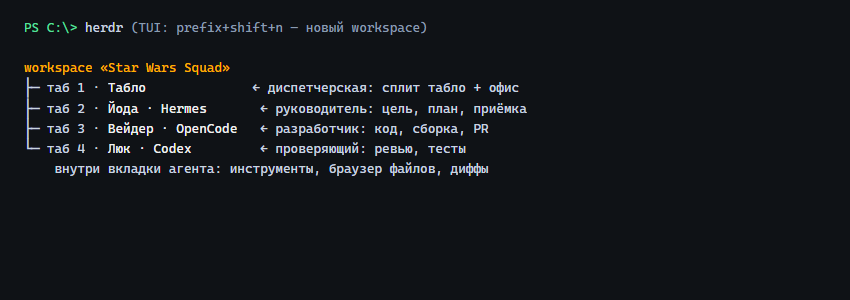
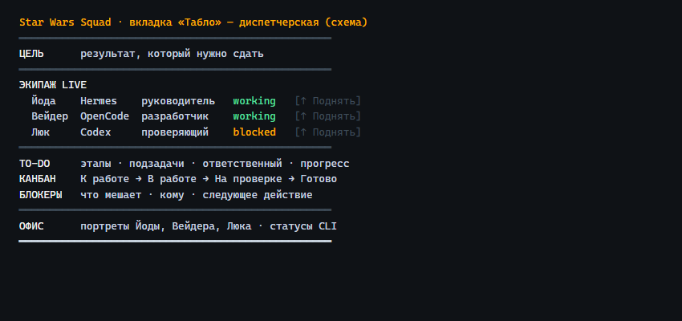

# Herdr Star Wars Squad

   [🇬🇧 English](README.en.md)

**Star Wars Squad** — готовая команда из четырёх AI-агентов для Herdr TUI, собранная по скиллу [herdr-setup](https://github.com/Kkoder-Cyclone/Herdr-skill-setup):

- **Йода** (Hermes) — руководитель: принимает цель, составляет план, распределяет задания, принимает итог;
- **Вейдер** (OpenCode) — разработчик: реализует, проверяет сборку, передаёт на проверку;
- **Люк** (Codex) — проверяющий: ревью, тесты, дефекты, подтверждение исправлений;
- **R2D2** (DeepSeek Harness + Z.ai Coding Plan) — технический дроид: автоматизация, диагностика, сбор фактов; базово GLM 5.3 Flash, тяжёлый режим GLM 5.3.

Маршрут работы: **пользователь → Йода → Вейдер → Люк → Йода → пользователь**.

Проверенный стек — **Herdr TUI**. GUI-оболочки не включены: ветка GUI ждёт отдельной проверки.

---

## Как устроено

```
herdr TUI
└─ workspace «Star Wars Squad»
   ├─ таб 1 · Табло                ← диспетчерская (сплит: табло + офис)
   ├─ таб 2 · Йода · Hermes        ← руководитель
   ├─ таб 3 · Вейдер · OpenCode    ← разработчик
   └─ таб 4 · Люк · Codex          ← проверяющий
       внутри вкладки агента: инструменты, браузер файлов, диффы
```

Каждый агент — отдельная вкладка (tab). Внутри вкладки агента открывай инструменты: сплиты, браузер файлов, просмотр диффов. Диспетчерская — вкладка **Табло**.



---

## Табло — диспетчерская

| Блок | Что показывает |
|---|---|
| **ЦЕЛЬ** | результат, который нужно сдать |
| **ЭКИПАЖ LIVE** | Йода · Вейдер · Люк / роль, статус, кнопка «↑ Поднять» |
| **TO-DO** | этапы цели, подзадачи, ответственный, проверенный прогресс |
| **КАНБАН** | К работе → В работе → На проверке → Готово |
| **БЛОКЕРЫ** | что мешает, кому, следующее действие |
| **ОФИС** | портреты, логотипы CLI, реальные статусы |



## Два режима работы

1. **Основная тройка.** Все в диспетчерской: Йода назначает, Вейдер реализует, Люк проверяет.
2. **Видимые помощники.** После отдельного разрешения каждый агент открывает по одному видимому CLI-помощнику в проектном workspace. Йода координирует. Не скрытые субагенты — включай только явно.

## Git-цикл: от карточки до merge

Git связан с карточкой задачи, не с названием вкладки:

| Стадия канбана | Ответственный | Критерий перехода |
|---|---|---|
| К работе | Йода | цель, критерий готовности, исполнитель, рабочая ветка |
| В работе | Вейдер | ветка, коммиты, тесты; push ветки + PR к основной |
| На проверке | Люк | ревью diff и тестов; замечания Вейдеру или одобрение SHA |
| Готово | Йода | проверки зелёные, слияние подтверждено, результат в карточке |

Напрямую в основную ветку не пушим. Конфликт и падение тестов — блокер в карточке, не обход.

---

## Быстрый старт

1. Поставь Herdr TUI: `irm https://herdr.dev/install.ps1 | iex` (Windows).
2. Дай агенту скилл [herdr-setup](https://github.com/Kkoder-Cyclone/Herdr-skill-setup).
3. Скажи агенту: «Собери команду Star Wars Squad по скиллу herdr-setup».
4. Или собери вручную по [docs/SETUP.md](docs/SETUP.md).

Подробности: [ARCHITECTURE.md](docs/ARCHITECTURE.md) · [SETUP.md](docs/SETUP.md) · [страница проекта](index.html)

---

## Что внутри

| Файл | Что это |
|---|---|
| `docs/ARCHITECTURE.md` | Архитектура: workspace, вкладки, Табло, режимы, маршрут, Git-цикл |
| `docs/SETUP.md` | Пошаговая сборка команды в TUI со скриншотами |
| `examples/registry.example.json` | Реестр команды: роли, CLI, пути, модели, маршрут |
| `examples/instructions/` | Шаблоны инструкций: общий AGENTS.md + личные yoda/vader/luke.md |
| `examples/wrappers/` | Рабочие wrapper: a-squad.cmd, a-team.cmd, agent-run.cmd |
| `agents/` | Рабочие места команды: yoda/AGENT.md (Hermes), vader/AGENT.md (OpenCode), luke/AGENT.md (Codex) |
| `plugins/` | Стартовый набор модов из коробки + порядок установки |
| `projects/` | Правила изоляции проектов |
| `skills/` | Скиллы: что есть из коробки, что доставить (дизайн, motion, браузер) |
| `AUTHORS.md` | Авторы: Codex — SKILL.md, K.ai в ZCode — документация и публикация |
| `screenshots/` | Скриншоты (только TUI) |
| `index.html` | Одностраничная версия (GitHub Pages) |

---

## Требования

1. Herdr TUI 0.9+ (`herdr --version`).
2. CLI: Hermes, OpenCode, Codex — установлены и авторизованы.
3. Node.js 20+ (OpenCode, Codex), Python 3.10+ (Hermes).
4. Git.

## Авторы

- **Codex** — исходная редакция SKILL.md (мастер настройки Herdr)
- **K.ai (Кай) в ZCode** — документация, скриншоты, страницы проекта, публикация

Подробности — [AUTHORS.md](AUTHORS.md).

## Лицензия

[MIT](LICENSE)
