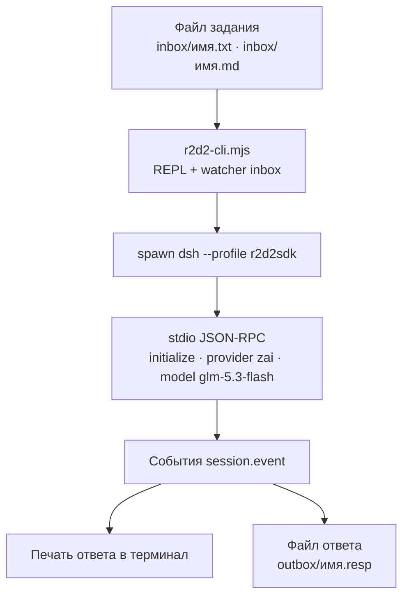

# R2D2 — технический дроид (DeepSeek Harness)

Модуль: REPL-служба поверх DeepSeek Harness CLI. Команда хоста: dsh. Дом модуля: D:\herdr\agents\r2d2.
Владелец документа: Кодовый. Карточка роли дроида: AGENTS.md в этой папке. Гайд парка: docs/HERDR-GUIDE.md, раздел 12.

## Архитектура

Порядок работы в одном списке:

1. Владелец или агент кладёт файл задания в inbox.
2. Watcher модуля забирает файл и переименовывает его в <имя>.taken — защита от повтора.
3. Модуль шлёт текст задания в сессию dsh через stdio JSON-RPC.
4. dsh возвращает события session.event.
5. Модуль печатает ответ и пишет файл outbox/<имя>.resp.

## Состав

| Файл или папка | Назначение |
|---|---|
| r2d2-cli.mjs | REPL плюс inbox/outbox служба |
| .dsh/profiles/r2d2sdk/cordis.patch.yml | маршрут Z.ai Coding Plan: baseURL https://api.z.ai/api/coding/paas/v4, apiKeyEnv ZAI_API_KEY, модели glm-5.3-flash и glm-5.3 |
| .dsh/profiles/r2d2/ | web-профиль, опция |
| AGENTS.md | карточка роли |
| inbox/ | файлы заданий: *.txt, *.md |
| outbox/ | файлы ответов: *.resp |
| service.log | журнал службы |

## Требования

1. dsh — глобальная установка npm @deepseek-ai/dsh. Канал next. Рабочая версия: 0.2.2-rc.3.
2. Node 22 или новее.
3. Переменная окружения ZAI_API_KEY уровня User в Windows.
4. Подписка Z.ai Coding Plan.

## Запуск, стоп, проверка

| Действие | Команда |
|---|---|
| Запуск службы | `node agents/r2d2/r2d2-cli.mjs --inbox` — фоном, из корня D:\herdr |
| Интерактив | вкладка herdr «R2D2 (dsh)» → `node r2d2-cli.mjs` |
| Стоп интерактива | команда /quit или Ctrl+C |
| Стоп фоновой службы | завершить процесс node r2d2-cli.mjs |

Проверка службы в одном списке:

1. Запусти службу.
2. Положи файл-пробу в inbox, например probe.txt.
3. Жди файл outbox/probe.resp. Файл пришёл — служба жива.
4. Смотри журнал службы: agents/r2d2/service.log.

Отладка: переменная R2D2_DEBUG=1 перед запуском. Переменная печатает служебные сообщения протокола.
Дополнительно: R2D2_INBOX_TIMEOUT — таймаут задания в мс, по умолчанию 300000.

## Модели

| Режим | Модель | Способ включения |
|---|---|---|
| Базовый | glm-5.3-flash | стоит по умолчанию |
| Тяжёлый | glm-5.3 | `R2D2_MODEL=glm-5.3 node r2d2-cli.mjs` |

Выбор модели идёт через переменную R2D2_MODEL. Профиль r2d2sdk держит обе модели в маршруте Z.ai.

## Диагностика

Известные ограничения:

1. dsh-tui версии 0.2.19 несовместим с dsh 0.1.5 и новее. Причина: разный wire-протокол, apiproxy против unary Remote. Вывод: TUI не используют, работа идёт только через REPL модуля.
2. REPL написан на SDK-протоколе версии rc.3. Методы: initialize, session, prompt, session.event. Смена версии dsh требует проверки протокола.
3. Сессии dsh хранятся в .dsh/sessions. Перезапуск REPL создаёт новую сессию с суффиксом. Контекст прошлой сессии в новую не переносится.

Порядок диагностики в одном списке:

1. Смотри журнал службы: service.log.
2. Запусти с R2D2_DEBUG=1 и повтори шаг.
3. Проверь версию dsh командой dsh --version. Ожидают 0.2.2-rc.3.
4. Проверь переменную ZAI_API_KEY.
