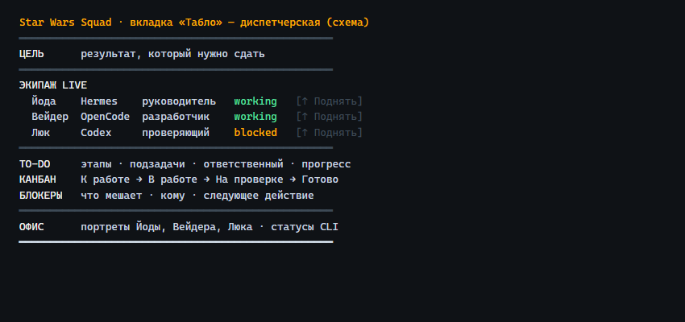
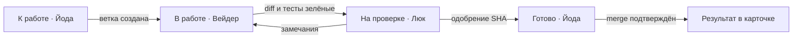

# Архитектура Star Wars Squad

## 1. Слои

```
Пользователь
  └─ Herdr TUI (сервер herdr держит терминалы)
      └─ workspace «Star Wars Squad»
          ├─ таб «Табло» — диспетчерская (сплит: табло + офис)
          ├─ таб «Йода · Hermes» — руководитель
          ├─ таб «Вейдер · OpenCode» — разработчик
          └─ таб «Люк · Codex» — проверяющий
```

Workspace — контейнер проекта в TUI. Таб — вкладка. Каждому агенту — свой таб. Внутри таба агента открывай инструменты: сплиты, браузер файлов, диффы. Сервер Herdr держит терминалы живыми при закрытом клиенте (detach).

## 2. Роли и маршрут

| ID | Имя | CLI | Роль |
|---|---|---|---|
| `yoda` | Магистр Йода | Hermes | Руководитель: цель, план, раздача, приёмка |
| `vader` | Дарт Вейдер | OpenCode | Разработчик: код, сборка, PR |
| `luke` | Люк Скайуокер | Codex | Проверяющий: ревью, тесты, дефекты |

Маршрут: **пользователь → Йода → Вейдер → Люк → Йода → пользователь**. Сохрани только согласованный маршрут. Тема не выдаёт полномочия.

## 3. Табло



Табло — единственная вкладка, где видна вся команда. Блоки:

| Блок | Содержание | Источник данных |
|---|---|---|
| ЦЕЛЬ | одна цель спринта | Йода записывает в to-do |
| ЭКИПАЖ LIVE | роль, статус, «↑ Поднять» | реестр + статусы CLI |
| TO-DO | этапы, подзадачи, исполнитель | карточки канбана строятся из этих же записей |
| КАНБАН | 4 стадии | стадия = колонка |
| БЛОКЕРЫ | причина, влияние, действие | отдельная строка и на карточке |
| ОФИС | портреты и статусы | логотипы CLI, реальные статусы |

Правило честности: показывай подтверждённые события с источником и временем. `unknown` не заменяй нулём или зелёным.

## 4. Два режима

1. **Основная тройка.** Все в диспетчерской: Йода назначает, Вейдер реализует, Люк проверяет. Тест на нейтральной цели.
2. **Видимые помощники.** После сдачи первого результата и отдельного разрешения: каждый агент открывает по одному видимому CLI-помощнику в проектном workspace. Каждый руководитель задаёт имя, вкладку, личный MD с областью задачи, подключает CLI. Йода координирует. Создатель завершает только своего помощника. Не скрытые субагенты.

## 5. Git-цикл

Git связан с карточкой задачи. В карточку пишем: ветку, commit SHA, ссылку на PR, проверки, блокер.



| Стадия | Ответственный | Критерий перехода |
|---|---|---|
| К работе | Йода | цель, критерий готовности, исполнитель, рабочая ветка |
| В работе | Вейдер | ветка, коммиты, тесты, push ветки, PR |
| На проверке | Люк | ревью diff и тестов; замечания или одобрение SHA |
| Готово | Йода | зелёные проверки, merge подтверждён, результат в карточке |

Напрямую в основную ветку не пушим. Force-push, переписывание истории и обход проверок — вне цикла. Merge ≠ деплой: проверь, не запускает ли merge автоматический деплой.

## 6. Реестр и инструкции

Реестр — `<root>/agents/registry`: ID, имя, alias, роль, CLI, executable/argv, cwd, профиль, пути инструкций, модель, маршрут, autostart. Пример — [examples/registry.example.json](../examples/registry.example.json).

Инструкции: общий `AGENTS.md` (состав, роли, маршрут, границы) + личные `yoda.md`, `vader.md`, `luke.md`. Подключение по runtime:

| Runtime | Общий контекст | Личный контекст |
|---|---|---|
| Hermes / Йода | проектный `AGENTS.md` | личная роль в `SOUL.md` активного профиля |
| Codex / Люк | `AGENTS.md` в cwd | инструкция/конфиг запуска |
| OpenCode / Вейдер | `AGENTS.md` | поле `instructions` в конфиге, слей, не затри |

Проверка памяти: в свежей сессии спроси без подсказки: «Назови имя, инструмент, роль, коллег, маршрут и загруженные инструкции». Ответ сверь с реестром. Заголовок вкладки не доказательство.

## 7. Wrapper `a squad`

```
a squad all          # workspace + Табло + поднять отсутствующих троих
a squad yoda         # целевой таб Йоды в Squad
a squad vader        # целевой таб Вейдера
a squad luke         # целевой таб Люка
```

Wrapper — интерфейс над штатным запуском. Бери пути из реестра, сверяй ID вкладок, не создавай дубли. Повторный `all` добирает недостающих. Примеры — [examples/wrappers/](../examples/wrappers/).

## 8. Приёмка

1. Тестовая цель: 1 задача, 2 подзадачи, полный круг канбана.
2. Тестовый блокер: показать и снять.
3. Вкладки = имена = роли; статусы живые.
4. Resize: данные и кнопки на месте, все участники видны.
5. Дубли не создаются при повторном `a squad all`.
6. Режим помощников — отдельным явным прогоном.
