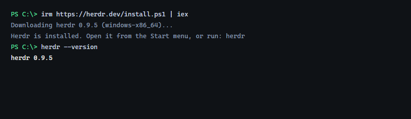
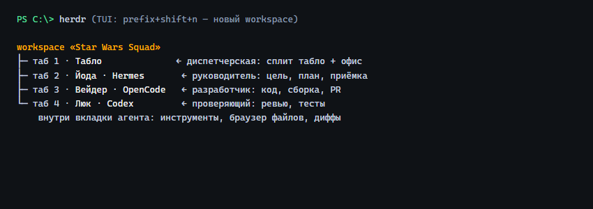
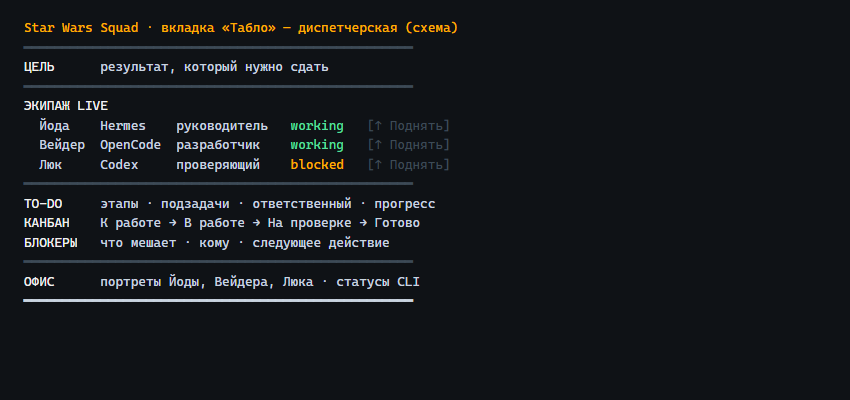

# Сборка Star Wars Squad в Herdr TUI

Пошаговый порядок. Предполагает установленный TUI и авторизованные CLI: Hermes, OpenCode, Codex.

## 1. Установи TUI

```powershell
irm https://herdr.dev/install.ps1 | iex   # Windows
herdr --version
```



## 2. Создай workspace и вкладки

В TUI: `prefix+shift+n` — новый workspace, назови **Star Wars Squad**. Внутри:

1. `prefix+shift+t` — переименуй первый таб в **Табло**.
2. `prefix+c` — новый таб, `prefix+shift+t` — «Йода · Hermes».
3. Ещё два таба: «Вейдер · OpenCode», «Люк · Codex».
4. Запусти CLI в каждом табе: Hermes, OpenCode, Codex штатными запусками.
5. `prefix+z` — зум панели; `prefix+v` / `prefix+-` — сплиты для инструментов внутри таба агента.



## 3. Табло

В табе «Табло» сделай нижний сплит под офис:

```
Табло (верхний сплит): ЦЕЛЬ · ЭКИПАЖ LIVE · TO-DO · КАНБАН · БЛОКЕРЫ
Табло (нижний сплит):  ОФИС — портреты, логотипы CLI, статусы
```

Схема: 



## 4. Реестр и инструкции

1. Реестр: `<root>/agents/registry` — скопируй [examples/registry.example.json](../examples/registry.example.json).
2. Общая инструкция: `AGENTS.md` — скопируй [examples/instructions/AGENTS.md](../examples/instructions/AGENTS.md).
3. Личные: `yoda.md`, `vader.md`, `luke.md` из той же папки.
4. Подключи по runtime — таблица в [ARCHITECTURE.md](ARCHITECTURE.md), раздел 6.
5. Проверка памяти: в свежей сессии спроси агента без подсказки: «Назови имя, инструмент, роль, коллег, маршрут и загруженные инструкции». Ответ сверь с реестром.

## 5. Wrapper `a squad`

Скопируй [examples/wrappers/a-squad.cmd](../examples/wrappers/a-squad.cmd) (Windows) или `a-team.cmd` — команда Маяка. Логика (рабочая версия, v0.2):

```
a squad all       # открыть workspace «Star Wars Squad», таб «Табло»,
                  # поднять только отсутствующих Йоду/Вейдера/Люка
a squad yoda      # целевой таб Йоды в Squad
```

Wrapper берёт пути из реестра, сверяет ID вкладок и не создаёт дубли. Статус по каждому: «уже работает / запущен / конкретная ошибка». Тест: `all` + три одиночные из двух разных каталогов, повторный `all` — без дублей.

## 6. Первый прогон (основная тройка)

1. Дай Йоде цель с критерием готовности.
2. Йода строит to-do, карточки канбана создаются из записей to-do.
3. Йода назначает Вейдеру — Вейдер ветка → коммиты → тесты → PR.
4. Люк ревьюит diff, тесты, критерии; замечания — Вейдеру, одобрение — Йоде.
5. Йода подтверждает слияние, результат в карточку.
6. Тестовый блокер: покажи в БЛОКЕРЫ и сними.

## 7. Приёмка

1. Полный круг канбана на тестовой цели — без ручных списков вне to-do.
2. Вкладки = имена = роли; статусы с источником и временем.
3. Resize: данные и кнопки на месте.
4. Повторный `a squad all` — без дублей.
5. Режим помощников — отдельным явным прогоном после сдачи первого результата.

Состояния установки — [ARCHITECTURE.md](ARCHITECTURE.md), раздел 8.
